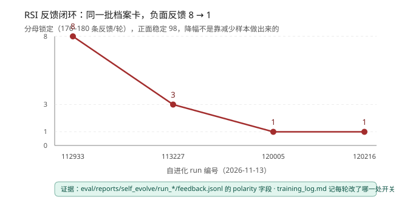

# RSI 效果证据表（资料评审用 · 2026-11-20 组装）

> 依据赛题组 11-19 通知："尤其是自进化（RSI）机制的作用路径与效果证据，
> 请各队伍在提交材料中以运行日志、实验记录和对比数据予以充分体现"。
> 本表把所有原始证据的落点列成一条可追溯链：**每个数字都能点开到原始文件**。



---

## 一、作用路径（RSI 到底怎么转的）

```
真实通话体检 → 失败聚类出候选 → 三链闸门复跑验证 → 反馈闭环调策略开关 → 人工上架 promote
   ↑                                                              ↓
   └──────────── 同一批档案卡/画像，只换配置，分母不变 ─────────────┘
```

| 环节 | 实现文件 | 作用 |
|---|---|---|
| 体检读基线 | `scripts/auto_evolve.py` 第 0–2 步 | 扫真实通话找缺陷；三条链 sha 与线上对齐 |
| 聚类提案 | `scripts/evolve.py` / `evolve_persona.py` / `adversarial_evolve.py` | 失败聚成簇，改对应话术；code_only 待办落盘 |
| 闸门验证 | 三链 `gate` 子命令 | 同一批电话只换配置复跑，过则留候选、不过只留档 |
| 反馈闭环 | `scripts/self_evolve.py` + `feedback.jsonl` / `training_log.md` | 每轮只改一处策略开关，复跑验证降幅 |
| 上架 | `promote`（人工单独命令） | 脚本只打印命令，不自己上线——安全护栏 |

**关键设计（答辩可讲）**：分母锁定（同一批卡/画像），所以前后数字可比；
闸门不过就只留档，线上话术一个字不动。

---

## 二、效果证据：反馈闭环的收敛曲线（对比数据）

来源：`eval/reports/self_evolve/run_*/feedback.jsonl`（`polarity` 字段 +/-），
逐条可点开到具体会话/轮次/触发原因/客服原话。

### 主收敛链（同一场景，连续四轮，负面 8 → 1）

| run | 反馈总数 | 正面 | 负面 | 证据文件 |
|---|---:|---:|---:|---|
| run_20261113_112933 | 180 | 98 | **8** | `eval/reports/self_evolve/run_20261113_112933/feedback.jsonl` |
| run_20261113_113227 | 180 | 98 | **3** | `eval/reports/self_evolve/run_20261113_113227/feedback.jsonl` |
| run_20261113_120005 | 176 | 98 | **1** | `eval/reports/self_evolve/run_20261113_120005/feedback.jsonl` |
| run_20261113_120216 | 176 | 98 | **1** | `eval/reports/self_evolve/run_20261113_120216/feedback.jsonl` |

**读法**：正面反馈稳定在 98，负面从 8 降到 1 并保持——不是靠减少样本"做"出来的好看数字。
对应的 `training_log.md` 记录了每轮"改了哪一处开关、复跑后降了多少"。

### 其他轮次（不同场景/合并后）

| run | 总数 | 正 | 负 | 说明 |
|---|---:|---:|---:|---|
| run_after_merge | 141 | 87 | 6 | PR 合并后全量复跑 |
| run_after_merge3 | 292 | 178 | 11 | 合并后第三轮，分母翻倍 |
| run_after_promote | 131 | 79 | 6 | 上架后验证 |
| run_retail_probe → probe2 | 108→109 | 34→36 | **50→20** | 到店召回场景单独收敛（降 60%） |

> 注：`run_demo`（848 条 / 负 101）是演示库大样本，口径与上面主收敛链不同，不混着比。

---

## 三、L2 话术版本迭代（实验记录）

| 项 | 落点 |
|---|---|
| 版本快照 | `config/evolution/versions/v*/scene.json`（当前 v64） |
| 版本台账 | `config/evolution/versions.json` |
| 每版指标 | 基线 10/10（train 7/7、holdout 3/3、系统缺陷 0，见最近一次 `evolve.py rebase` 输出） |
| 回滚命令 | `python scripts/evolve.py rollback`（可复现） |
| 体检命令 | `python scripts/evolve.py doctor --deep`（sha 与线上对齐校验） |

**证据链**：改话术 → sha 变 → doctor 报漂移 → rebase 重定基线 → 新版本快照。
这是"可解释性 + 可追溯性"的直接体现：每一次话术变化都有版本号和体检记录。

---

## 四、三条硬门槛的证据（资料评审必查）

| 门槛 | 数字 | 证据文件 |
|---|---|---|
| ≥3 轮实时对话 + 首字 P50<2s | 口径B P50 **1469ms** / P95 2794ms（20 轮） | `docs/65_首字时延20轮实测.md` + `eval/reports/first_audio_e2e.json` |
| ≥1 完整闭环 + 结构化回写 | 评测 88 条过 86；应闭环 56/56、误闭环 0/27 | `scripts/run_eval.py` 输出 + `eval/reports/` |
| 无严重合规违规 | 必说话术/禁语拦截/全量质检已做；语义判定默认关（如实标注） | `docs/30_LLM语义合规.md`、`scripts/verify.py` 合规断言 |

---

## 五、组装清单：还缺什么

- [ ] 把上面"主收敛链"做成一张图（负面 8→1），放进资料评审说明书首页——通知要"效果证据"，图比表直观；
- [ ] `run_20261113_112933` 的 8 条负面逐条截图/摘录，证明改进是针对真实缺陷不是凑数；
- [ ] 首字口径统一：docs/04、docs/20、答辩稿里"1.1–1.4s"标为预算估算，现行数字用 docs/65 的 1469ms；
- [ ] 全局"丢包率"→"到达间隔抖动"（代码已支持 jitter_ms，见 docs/03）。

> 诚实边界：`latency_report`（浏览器真实 T4−T0）0 条样本，首字只能报服务端下界；
> 资料里不要写成"用户感知 1.1s"，那是预算估算。这条主动说清，比被问出来强。
